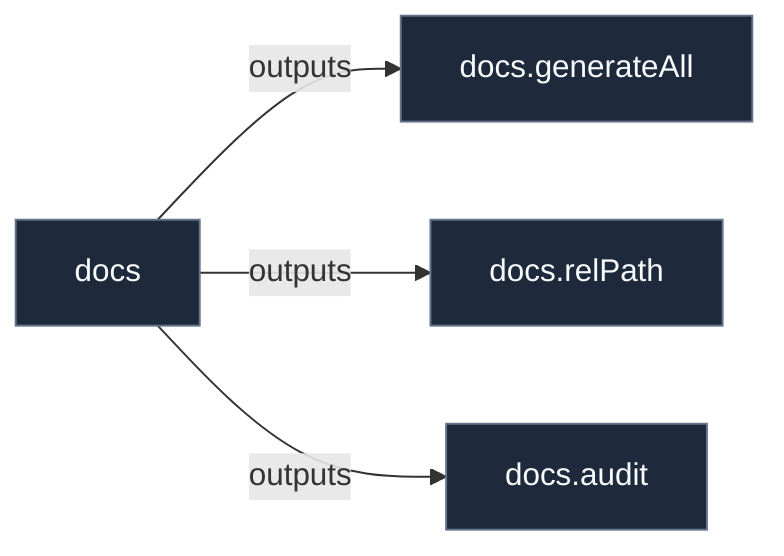

# Library: `docs`

Documentation generator turning the `docs` page registry, primitive metadata, and the architecture graph into markdown.

[← Back to Library Documentation](README.md) | [← Back to Main README](../../README.md)

- **Library**: `flake.lib.docs`
- **Definition File**: [`meta/docs/render.nix`](../../meta/docs/render.nix)

<details>
<summary>Architecture Diagram (click to expand)</summary>



</details>

## Usage

This library namespace can be consumed both internally within repository modules and externally by downstream flakes.

### Internal Usage

```nix
{ self, lib, pkgs, ... }: {
  example = self.lib.docs.audit;
}
```

### External Usage

```nix
{
  inputs.nixconf.url = "github:LW-54/nixconf";

  outputs = { self, nixconf, ... }: {
    example = nixconf.lib.docs.audit;
  };
}
```

## Exported Symbols

<a id="audit"></a>
### `audit`

Documentation coverage and quality health report.

#### Type

```
audit :: AttrSet
```

<a id="generateAll"></a>
### `generateAll`

Renders every page registered under `config.docs.pages` into an attribute set mapping repository-relative paths to markdown.

#### Inputs

- `system`: Platform used to evaluate packages and the architecture graph (default: "x86_64-linux").
- `cpg`: Pre-computed Semantic Code Property Graph (optional).
- `graph`: Pre-computed architecture graph (optional).

#### Type

```
generateAll :: AttrSet -> AttrSet
```

#### Examples

```nix
builtins.attrNames (self.lib.docs.generateAll {})
```

<a id="relPath"></a>
### `relPath`

Computes the relative markdown link from one repository file to another path (optionally with an `#anchor`).

#### Inputs

- `from`: Repository-relative path of the page containing the link.
- `to`: Repository-relative target path, optionally suffixed by `#anchor`.

#### Type

```
relPath :: String -> String -> String
```

#### Examples

```nix
relPath "docs/hosts/x240.md" "docs/contracts/home.md"
=> "../contracts/home.md"
```
