# Library: `graph`

Canonical Semantic Code Property Graph (CPG) framework, algebraic calculus, and architectural projection functors.

[← Back to Library Documentation](README.md) | [← Back to Main README](../../README.md)

- **Library**: `flake.lib.graph`
- **Definition File**: [`meta/graph/default.nix`](../../meta/graph/default.nix)

```mermaid
flowchart LR
  urn__nixconf__ast__function__graph_backwardSlice["graph.backwardSlice"]:::defaultNode
    urn__nixconf__ast__function__graph_buildCPG["graph.buildCPG"]:::defaultNode
    urn__nixconf__ast__function__graph_buildGraph["graph.buildGraph"]:::defaultNode
    urn__nixconf__ast__function__graph_filterGraph["graph.filterGraph"]:::defaultNode
    urn__nixconf__ast__function__graph_findConsumers["graph.findConsumers"]:::defaultNode
    urn__nixconf__ast__function__graph_findImplementers["graph.findImplementers"]:::defaultNode
    urn__nixconf__ast__function__graph_findOptionFlows["graph.findOptionFlows"]:::defaultNode
    urn__nixconf__ast__function__graph_forwardSlice["graph.forwardSlice"]:::defaultNode
    urn__nixconf__ast__function__graph_getNeighborhood["graph.getNeighborhood"]:::defaultNode
    urn__nixconf__ast__function__graph_getOptionValue["graph.getOptionValue"]:::defaultNode
    urn__nixconf__ast__function__graph_renderEntity["graph.renderEntity"]:::defaultNode
    urn__nixconf__ast__function__graph_renderMatrix["graph.renderMatrix"]:::defaultNode
    urn__nixconf__ast__function__graph_renderMermaid["graph.renderMermaid"]:::defaultNode
    urn__nixconf__ast__function__graph_renderTable["graph.renderTable"]:::defaultNode
    urn__nixconf__ast__function__graph_renderTree["graph.renderTree"]:::defaultNode
    urn__nixconf__ast__function__graph_toArchitectureLPG["graph.toArchitectureLPG"]:::defaultNode
    urn__nixconf__ast__symbol__graph_query["graph.query"]:::defaultNode
    urn__nixconf__ast__symbol__graph_render["graph.render"]:::defaultNode
    urn__nixconf__onto__lib__graph["graph"]:::defaultNode

    urn__nixconf__onto__lib__graph -->|outputs| urn__nixconf__ast__function__graph_backwardSlice
    urn__nixconf__onto__lib__graph -->|outputs| urn__nixconf__ast__function__graph_buildCPG
    urn__nixconf__onto__lib__graph -->|outputs| urn__nixconf__ast__function__graph_buildGraph
    urn__nixconf__onto__lib__graph -->|outputs| urn__nixconf__ast__function__graph_filterGraph
    urn__nixconf__onto__lib__graph -->|outputs| urn__nixconf__ast__function__graph_findConsumers
    urn__nixconf__onto__lib__graph -->|outputs| urn__nixconf__ast__function__graph_findImplementers
    urn__nixconf__onto__lib__graph -->|outputs| urn__nixconf__ast__function__graph_findOptionFlows
    urn__nixconf__onto__lib__graph -->|outputs| urn__nixconf__ast__function__graph_forwardSlice
    urn__nixconf__onto__lib__graph -->|outputs| urn__nixconf__ast__function__graph_getNeighborhood
    urn__nixconf__onto__lib__graph -->|outputs| urn__nixconf__ast__function__graph_getOptionValue
    urn__nixconf__onto__lib__graph -->|outputs| urn__nixconf__ast__function__graph_renderEntity
    urn__nixconf__onto__lib__graph -->|outputs| urn__nixconf__ast__function__graph_renderMatrix
    urn__nixconf__onto__lib__graph -->|outputs| urn__nixconf__ast__function__graph_renderMermaid
    urn__nixconf__onto__lib__graph -->|outputs| urn__nixconf__ast__function__graph_renderTable
    urn__nixconf__onto__lib__graph -->|outputs| urn__nixconf__ast__function__graph_renderTree
    urn__nixconf__onto__lib__graph -->|outputs| urn__nixconf__ast__function__graph_toArchitectureLPG
    urn__nixconf__onto__lib__graph -->|outputs| urn__nixconf__ast__symbol__graph_query
    urn__nixconf__onto__lib__graph -->|outputs| urn__nixconf__ast__symbol__graph_render


    click urn__nixconf__ast__function__graph_backwardSlice href "graph.md" "graph.backwardSlice"
    click urn__nixconf__ast__function__graph_buildCPG href "graph.md" "graph.buildCPG"
    click urn__nixconf__ast__function__graph_buildGraph href "graph.md" "graph.buildGraph"
    click urn__nixconf__ast__function__graph_filterGraph href "graph.md" "graph.filterGraph"
    click urn__nixconf__ast__function__graph_findConsumers href "graph.md" "graph.findConsumers"
    click urn__nixconf__ast__function__graph_findImplementers href "graph.md" "graph.findImplementers"
    click urn__nixconf__ast__function__graph_findOptionFlows href "graph.md" "graph.findOptionFlows"
    click urn__nixconf__ast__function__graph_forwardSlice href "graph.md" "graph.forwardSlice"
    click urn__nixconf__ast__function__graph_getNeighborhood href "graph.md" "graph.getNeighborhood"
    click urn__nixconf__ast__function__graph_getOptionValue href "graph.md" "graph.getOptionValue"
    click urn__nixconf__ast__function__graph_renderEntity href "graph.md" "graph.renderEntity"
    click urn__nixconf__ast__function__graph_renderMatrix href "graph.md" "graph.renderMatrix"
    click urn__nixconf__ast__function__graph_renderMermaid href "graph.md" "graph.renderMermaid"
    click urn__nixconf__ast__function__graph_renderTable href "graph.md" "graph.renderTable"
    click urn__nixconf__ast__function__graph_renderTree href "graph.md" "graph.renderTree"
    click urn__nixconf__ast__function__graph_toArchitectureLPG href "graph.md" "graph.toArchitectureLPG"
    click urn__nixconf__ast__symbol__graph_query href "graph.md" "graph.query"
    click urn__nixconf__ast__symbol__graph_render href "graph.md" "graph.render"
    click urn__nixconf__onto__lib__graph href "graph.md" "graph"

  %% Semantic Visual Classes
  classDef hostNode fill:#1e293b,stroke:#38bdf8,stroke-width:2px,color:#f8fafc;
  classDef contractNode fill:#1e1b4b,stroke:#818cf8,stroke-width:2px,color:#f8fafc;
  classDef implNode fill:#0f172a,stroke:#34d399,stroke-width:2px,color:#f8fafc;
  classDef featureNode fill:#134e4a,stroke:#2dd4bf,stroke-width:2px,color:#f8fafc;
  classDef optNode fill:#422006,stroke:#facc15,stroke-width:1px,color:#fefce8;
  classDef typeNode fill:#3b0764,stroke:#c084fc,stroke-width:1px,color:#faf5ff;
  classDef pkgNode fill:#4c0519,stroke:#fb7185,stroke-width:1px,color:#fff1f2;
  classDef devShellNode fill:#451a03,stroke:#fb923c,stroke-width:1px,color:#fff7ed;
  classDef drvNode fill:#18181b,stroke:#a1a1aa,stroke-width:1px,color:#f4f4f5;
  classDef defaultNode fill:#1e293b,stroke:#64748b,stroke-width:1px,color:#f8fafc;
```

<details>
<summary>Architecture Diagram (click to expand)</summary>



</details>

## Usage

This library namespace can be consumed both internally within repository modules and externally by downstream flakes.

### Internal Usage

```nix
{ self, lib, pkgs, ... }: {
  example = self.lib.graph.backwardSlice;
}
```

### External Usage

```nix
{
  inputs.nixconf.url = "github:LW-54/nixconf";

  outputs = { self, nixconf, ... }: {
    example = nixconf.lib.graph.backwardSlice;
  };
}
```

## Exported Symbols

<a id="backwardSlice"></a>
### `backwardSlice`

Computes a backward program slice along incoming edges up to maxDepth.

#### Inputs

- `cpg`: Semantic Code Property Graph attribute set.
- `nodeId`: Canonical identifier of the target node.
- `maxDepth`: Maximum traversal depth (defaults to 10).
- `layers`: List of CPG strata to traverse (optional, defaults to all).
- `relations`: Optional list of specific relations to filter traversal (defaults to null for all).

#### Type

```
backwardSlice :: AttrSet -> AttrSet
```

<a id="buildCPG"></a>
### `buildCPG`

Extracts and constructs the unified Semantic Code Property Graph (CPG) merging Ontological, AST, Evaluation/PDG, and Derivation strata.

#### Inputs

- `system`: Architecture target system string (defaults to "x86_64-linux").

#### Type

```
buildCPG :: AttrSet -> AttrSet
```

<a id="buildGraph"></a>
### `buildGraph`

Builds the complete macro architectural graph directly from evaluated flake declarations.

#### Inputs

- `system`: Architecture target system string (defaults to "x86_64-linux").

#### Type

```
buildGraph :: AttrSet -> AttrSet
```

<a id="filterGraph"></a>
### `filterGraph`

Filters a labeled property graph by applying node and edge predicate functions.

#### Inputs

- `nodeFilter`: Predicate function filtering nodes by attributes (defaults to keeping all nodes).
- `edgeFilter`: Predicate function filtering edges by attributes (defaults to keeping all edges).
- `graph`: The input labeled property graph attribute set.

#### Type

```
filterGraph :: AttrSet -> AttrSet -> AttrSet
```

<a id="findConsumers"></a>
### `findConsumers`

Finds all consumer instances defining options or sending data into a target contract.

#### Inputs

- `cpg`: Semantic Code Property Graph attribute set.
- `contractId`: Canonical identifier of the contract (e.g. "persistence" or "contract:persistence").

#### Type

```
findConsumers :: AttrSet -> AttrSet
```

<a id="findImplementers"></a>
### `findImplementers`

Finds all active implementers fulfilling a target contract.

#### Inputs

- `cpg`: Semantic Code Property Graph attribute set.
- `contractId`: Canonical identifier of the contract (e.g. "persistence" or "contract:persistence").

#### Type

```
findImplementers :: AttrSet -> AttrSet
```

<a id="findOptionFlows"></a>
### `findOptionFlows`

Extracts the dataflow channels and writer/reader nodes for a specific option path.

#### Inputs

- `cpg`: Semantic Code Property Graph attribute set.
- `optionPath`: Option path string (e.g. "secrets.files").

#### Type

```
findOptionFlows :: AttrSet -> AttrSet
```

<a id="forwardSlice"></a>
### `forwardSlice`

Computes a forward program slice along outgoing edges up to maxDepth.

#### Inputs

- `cpg`: Semantic Code Property Graph attribute set.
- `nodeId`: Canonical identifier of the starting node.
- `maxDepth`: Maximum traversal depth (defaults to 10).
- `layers`: List of CPG strata to traverse (optional, defaults to all).
- `relations`: Optional list of specific relations to filter traversal (defaults to null for all).

#### Type

```
forwardSlice :: AttrSet -> AttrSet
```

<a id="getNeighborhood"></a>
### `getNeighborhood`

Extracts an undirected k-hop neighborhood surrounding a center node up to the specified traversal depth.

#### Inputs

- `depth`: Graph traversal depth radius (defaults to 1).
- `graph`: The complete labeled property graph attribute set.
- `nodeId`: Canonical identifier of the center node.

#### Type

```
getNeighborhood :: AttrSet -> AttrSet
```

<a id="getOptionValue"></a>
### `getOptionValue`

Retrieves the scalar resolved value for a contract option on a specific host from the CPG.

#### Inputs

- `cpg`: Semantic Code Property Graph attribute set.
- `host`: Host identifier string.
- `optionPath`: Option path string (e.g. "default-user.username").

#### Type

```
getOptionValue :: AttrSet -> Any
```

<a id="query"></a>
### `query`

Fluent graph query selectors, pathfinding, and DAG hierarchy traversal.

#### Type

```
query :: AttrSet
```

<a id="render"></a>
### `render`

Universal presentation engine for rendering any graph into Markdown tables, trees, matrices, entity sheets, and styled Mermaid flowcharts.

#### Type

```
render :: AttrSet
```

<a id="renderEntity"></a>
### `renderEntity`

Entity sheet generator providing comprehensive markdown inspection cards for graph nodes.

#### Inputs

- `graph`: The labeled property graph containing the node.
- `includeNeighborhoodDiagram`: Boolean flag to embed a Mermaid 1-hop neighborhood diagram (defaults to true).
- `mermaidRenderer`: Optional custom function to render a Mermaid diagram from a subgraph (defaults to null).
- `node`: The target node attribute set to inspect.

#### Type

```
renderEntity :: AttrSet -> String
```

<a id="renderMatrix"></a>
### `renderMatrix`

Two-dimensional cross-tabulation and relationship matrix markdown generator.

#### Inputs

- `cellFn`: Custom cell renderer function receiving `{ row, col, edges, matched }` (optional, defaults to null).
- `colLabel`: Display title extractor for column entities (optional, defaults to `c.name or c.id`).
- `cols`: List of column entities or nodes.
- `graph`: Graph attribute set containing edges to match (optional, defaults to null).
- `relation`: Optional edge relation name filter (e.g. "implements", "CONSUMES") (defaults to null).
- `rowHeader`: Header title for the row index column (defaults to "Entity").
- `rowLabel`: Display title extractor for row entities (optional, defaults to `r.name or r.id`).
- `rows`: List of row entities or nodes.

#### Type

```
renderMatrix :: AttrSet -> String
```

<a id="renderMermaid"></a>
### `renderMermaid`

Advanced Mermaid flowchart renderer with clustering, hyperlinked click events, and semantic class styling.

#### Inputs

- `clusterBy`: Optional clustering criterion (e.g. "stratum", "kind", or a grouping lambda) (defaults to null).
- `customEdgeFormatter`: Optional custom formatting function for graph edges (defaults to null).
- `customNodeFormatter`: Optional custom formatting function for graph nodes (defaults to null).
- `graph`: The labeled property graph attribute set.
- `includeTheme`: Boolean flag to append semantic CSS class definitions (defaults to true).
- `layout`: Flowchart orientation direction ("TD", "LR", "TB", etc.) (defaults to "TD").
- `linkFn`: Optional function returning an interactive URL string for a node (defaults to null).
- `raw`: Boolean flag to suppress markdown code block fence wrapping (defaults to false).
- `title`: Optional flowchart diagram title string (defaults to null).
- `tooltipFn`: Optional function returning tooltip hover text for a node (defaults to null).
- `wrapCodeBlock`: Boolean flag to enclose flowchart in a markdown ```mermaid code block (defaults to true).

#### Type

```
renderMermaid :: AttrSet -> String
```

<a id="renderTable"></a>
### `renderTable`

Universal markdown table generator with configurable column extractors, alignments, and sorting.

#### Inputs

- `align`: List of column alignments ("left", "center", "right") (optional, defaults to empty).
- `columns`: List of column extraction functions or attribute names.
- `headers`: List of column header title strings.
- `reverse`: Boolean flag to reverse row ordering (optional, defaults to false).
- `rows`: List of row data items or entity attribute sets.
- `sortBy`: Optional sorting key lambda (Row -> Comparable) (defaults to null).

#### Type

```
renderTable :: AttrSet -> String
```

<a id="renderTree"></a>
### `renderTree`

Hierarchical tree generator supporting markdown bullet lists and ASCII tree formats.

#### Inputs

- `format`: Optional format style alias ("markdown" or "ascii") (defaults to null).
- `formatNode`: Optional node display formatting function (defaults to null).
- `graph`: The labeled property graph attribute set.
- `maxDepth`: Maximum recursion depth for tree traversal (defaults to 10).
- `relation`: Optional edge relation name filter (defaults to null).
- `roots`: List of root node IDs or root node attribute sets.
- `style`: Formatting style ("markdown" or "ascii") (defaults to "markdown").

#### Type

```
renderTree :: AttrSet -> String
```

<a id="toArchitectureLPG"></a>
### `toArchitectureLPG`

Projects the fine-grained Semantic CPG into the macro architectural graph (LPG).

#### Inputs

- `cpg`: The evaluated Semantic Code Property Graph attribute set.

#### Type

```
toArchitectureLPG :: AttrSet -> AttrSet
```
