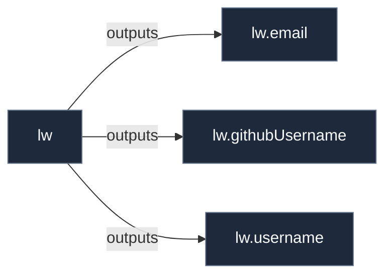

# Library: `lw`

Primary human user account orchestration and identity provisioning.

[← Back to Library Documentation](README.md) | [← Back to Main README](../../README.md)

- **Library**: `flake.lib.lw`
- **Definition File**: [`modules/implementations/lw.nix`](../../modules/implementations/lw.nix)

<details>
<summary>Architecture Diagram (click to expand)</summary>



</details>

## Usage

This library namespace can be consumed both internally within repository modules and externally by downstream flakes.

### Internal Usage

```nix
{ self, lib, pkgs, ... }: {
  example = self.lib.lw.email;
}
```

### External Usage

```nix
{
  inputs.nixconf.url = "github:LW-54/nixconf";

  outputs = { self, nixconf, ... }: {
    example = nixconf.lib.lw.email;
  };
}
```

## Exported Symbols

<a id="email"></a>
### `email`

Primary email address for user account lw.

#### Type

```
email :: String
```

<a id="githubUsername"></a>
### `githubUsername`

Primary GitHub account username for user account lw.

#### Type

```
githubUsername :: String
```

<a id="username"></a>
### `username`

Primary login username for user account lw.

#### Type

```
username :: String
```
