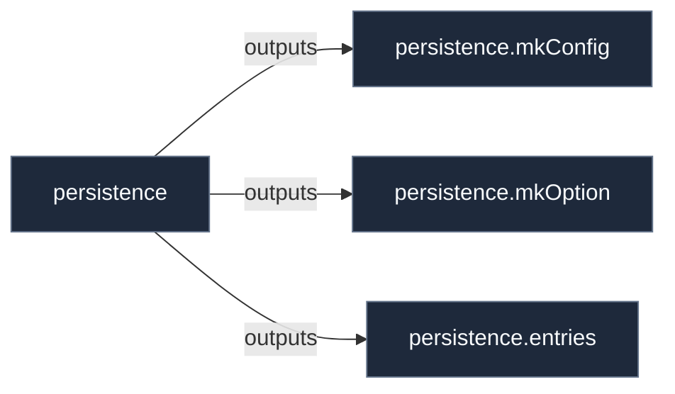

# Library: `persistence`

Library helpers and constructors for the 'persistence' contract.

[← Back to Library Documentation](README.md) | [← Back to Main README](../../README.md)

- **Library**: `flake.lib.persistence`
- **Definition File**: [`modules/contracts/persistence.nix`](../../modules/contracts/persistence.nix)

<details>
<summary>Architecture Diagram (click to expand)</summary>



</details>

## Usage

This library namespace can be consumed both internally within repository modules and externally by downstream flakes.

### Internal Usage

```nix
{ self, lib, pkgs, ... }: {
  example = self.lib.persistence.entries;
}
```

### External Usage

```nix
{
  inputs.nixconf.url = "github:LW-54/nixconf";

  outputs = { self, nixconf, ... }: {
    example = nixconf.lib.persistence.entries;
  };
}
```

## Exported Symbols

<a id="entries"></a>
### `entries`

List of directory or file paths to persist, either strings or custom bind-mount attribute sets.

#### Type

```
entries :: Type
```

<a id="mkConfig"></a>
### `mkConfig`

Auto-derived configuration binding helper for the 'persistence' contract.

#### Inputs

- `cfg`: Configuration binding parameter for the 'persistence' contract.
- `config`: Configuration binding parameter for the 'persistence' contract.

#### Type

```
persistence.mkConfig :: AttrSet -> AttrSet
```

#### Examples

```nix
persistence.mkConfig { inherit config cfg; }
```

<a id="mkOption"></a>
### `mkOption`

Auto-derived option constructor for the 'persistence' contract.

#### Inputs

- `args`: Service-specific options to include.

#### Type

```
persistence.mkOption :: AttrSet -> AttrSet
```

#### Examples

```nix
persistence.mkOption { ... }
```

<a id="types"></a>
### `types`

Custom option types declared under this library namespace:

- `entries`: list of (string or attribute set of anything)
- `user`: submodule
