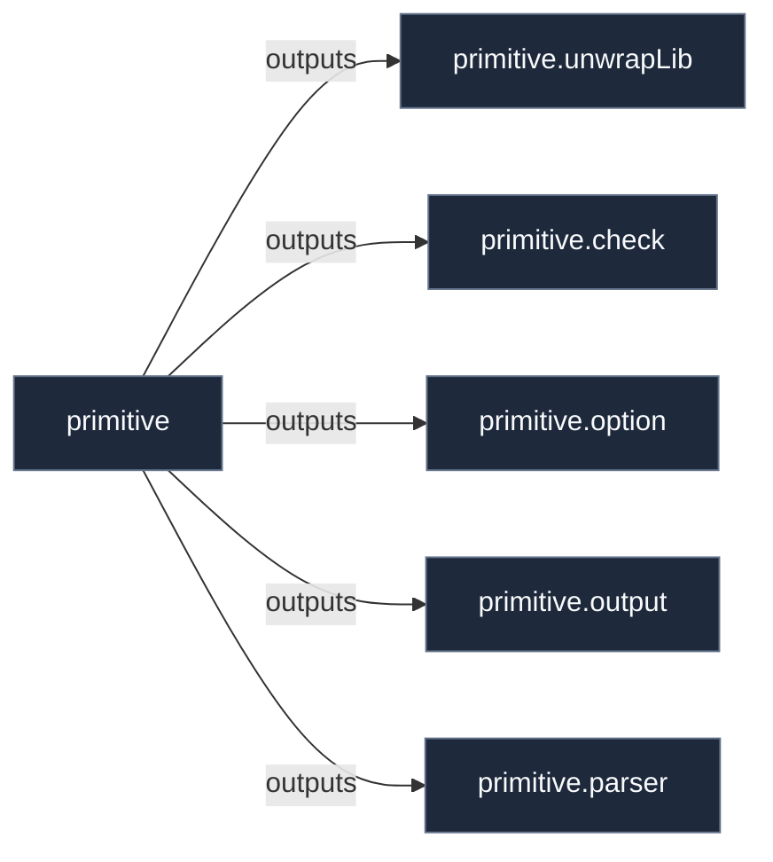

# Library: `primitive`

Primitives framework helper functions, option constructors, and utilities.

[← Back to Library Documentation](README.md) | [← Back to Main README](../../README.md)

- **Library**: `flake.lib.primitive`
- **Definition File**: [`primitives/primitive/default.nix`](../../primitives/primitive/default.nix)

<details>
<summary>Architecture Diagram (click to expand)</summary>



</details>

## Usage

This library namespace can be consumed both internally within repository modules and externally by downstream flakes.

### Internal Usage

```nix
{ self, lib, pkgs, ... }: {
  example = self.lib.primitive.check;
}
```

### External Usage

```nix
{
  inputs.nixconf.url = "github:LW-54/nixconf";

  outputs = { self, nixconf, ... }: {
    example = nixconf.lib.primitive.check;
  };
}
```

## Exported Symbols

<a id="check"></a>
### `check`

Generic validation check constructors, predicates, and style specification verifiers.

#### Type

```
check :: AttrSet

# Values
- `cleanMsg msg`: Normalizes multiline messages into single-line strings.
- `recordTodo diag`: Standard diagnostic constructor emitting evaluation warnings.
- `validOption args`: Validates individual NixOS option declarations.
- `validOptions inst`: Validates all options in a contract or submodule tree.
- `validFunction args`: Validates RFC 145 function docstrings and parameter drift.
- `validDocstring args`: Validates symbol docstring summaries and signatures.
- `validSymbols inst`: Validates all symbols in a library instance.
- `validMeta inst`: Validates metadata descriptions on packages and shells.
- `mkCheck predicate [message]`: Constructs a custom check from a predicate function.
- `hasAttr attr [message]`: Validates that an attribute exists on the instance.
- `hasAttrs attr [message]`: Validates that an attribute exists and is an attribute set.
- `hasNonEmptyAttrs attr [message]`: Validates that an attribute is a non-empty attribute set.
- `hasString attr [message]`: Validates that an attribute is a non-empty string.
- `hasFunction attr [message]`: Validates that an attribute is a function.
- `any checkList [message]`: Validates that at least one check passes.
- `all checkList [message]`: Validates that all checks pass.
```

<a id="option"></a>
### `option`

Pre-configured option constructors for primitive definitions with automatic descriptions and functor override support.

#### Type

```
option :: AttrSet
```

<a id="output"></a>
### `output`

Pre-configured output generator helpers for aggregating flake outputs.

#### Type

```
output :: AttrSet
```

<a id="parser"></a>
### `parser`

Pure-Nix RFC 145 docstring parser utilities for functions and library symbols.

#### Type

```
parser :: AttrSet

# Values
- `stripLeadingIndentation text`: Strips common indentation whitespace.
- `parseDocstring rawComment`: Parses structured RFC 145 docstring sections.
```

<a id="unwrapLib"></a>
### `unwrapLib`

Unwraps documented symbols from an attribute set, extracting `.value` if present or stripping `.docstring` metadata.

#### Inputs

- `attrs`: Attribute set containing documented symbol definitions.

#### Type

```
unwrapLib :: AttrSet -> AttrSet
```
