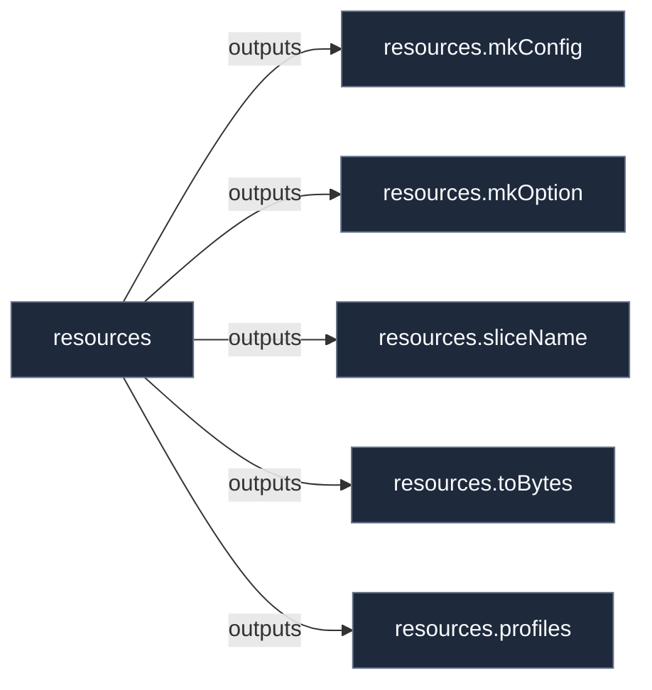

# Library: `resources`

Library helpers and constructors for the 'resources' contract.

[← Back to Library Documentation](README.md) | [← Back to Main README](../../README.md)

- **Library**: `flake.lib.resources`
- **Definition File**: [`modules/contracts/resources/default.nix`](../../modules/contracts/resources/default.nix)

<details>
<summary>Architecture Diagram (click to expand)</summary>



</details>

## Usage

This library namespace can be consumed both internally within repository modules and externally by downstream flakes.

### Internal Usage

```nix
{ self, lib, pkgs, ... }: {
  example = self.lib.resources.mkConfig;
}
```

### External Usage

```nix
{
  inputs.nixconf.url = "github:LW-54/nixconf";

  outputs = { self, nixconf, ... }: {
    example = nixconf.lib.resources.mkConfig;
  };
}
```

## Exported Symbols

<a id="mkConfig"></a>
### `mkConfig`

Auto-derived configuration binding helper for the 'resources' contract.

#### Inputs

- `cfg`: Configuration binding parameter for the 'resources' contract.
- `config`: Configuration binding parameter for the 'resources' contract.
- `units`: Configuration binding parameter for the 'resources' contract.

#### Type

```
resources.mkConfig :: AttrSet -> AttrSet
```

#### Examples

```nix
resources.mkConfig { inherit config cfg; }
```

<a id="mkOption"></a>
### `mkOption`

Auto-derived option constructor for the 'resources' contract.

#### Inputs

- `cpu`: Submodule option parameter for the 'resources' contract.
- `deferOnBattery`: Submodule option parameter for the 'resources' contract.
- `enable`: Submodule option parameter for the 'resources' contract.
- `io`: Submodule option parameter for the 'resources' contract.
- `memory`: Submodule option parameter for the 'resources' contract.
- `oom`: Submodule option parameter for the 'resources' contract.
- `tasksMax`: Submodule option parameter for the 'resources' contract.
- `tier`: Submodule option parameter for the 'resources' contract.
- `units`: Submodule option parameter for the 'resources' contract.

#### Type

```
resources.mkOption :: AttrSet -> AttrSet
```

#### Examples

```nix
resources.mkOption { ... }
```

<a id="profiles"></a>
### `profiles`

Built-in host workload resource tier profiles (`server` and `workstation`) mapped to systemd slices.

#### Type

```
profiles :: AttrSet
```

<a id="sliceName"></a>
### `sliceName`

Normalize a resource tier name into its canonical systemd `.slice` unit name.

#### Inputs

- `tier`: Workload tier name (with or without `.slice` suffix).

#### Type

```
sliceName :: String -> String
```

#### Examples

```nix
resources.sliceName "critical" # => "critical.slice"
```

<a id="toBytes"></a>
### `toBytes`

Convert an integer or byte-size string (`B`, `K`, `M`, `G`, `T`, `P`) into an exact integer byte count.

#### Inputs

- `x`: Non-negative integer bytes or size string such as `"512M"` or `"1.5G"`.

#### Type

```
toBytes :: (Int | String) -> Int
```

#### Examples

```nix
resources.toBytes "512M" # => 536870912
```

<a id="types"></a>
### `types`

Custom option types declared under this library namespace:

- `byteSize`: Byte size as an integer or systemd size string with `B`, `K`, `M`, `G`, `T`, or `P` suffix (e.g. `512M`, `2G`).
- `cgroupWeight`: Cgroups v2 relative scheduling weight integer strictly between `1` and `10000`.
- `cpuQuota`: Systemd `CPUQuota=` percentage string (e.g. `50%`, `150%`).
- `disk`: System-wide local disk headroom and garbage-collection threshold submodule.
- `onBattery`: Power-policy override submodule defining reduced CPU and I/O limits applied to a tier while on battery.
- `oom`: Host-wide `systemd-oomd` configuration submodule.
- `oomPreference`: Systemd `ManagedOOMPreference` policy (`none`, `avoid`, or `omit`).
- `oomScore`: Linux kernel `OOMScoreAdjust` integer strictly between `-1000` and `1000`.
- `percentage`: Percentage string strictly between `0%` and `100%`.
- `power`: Host power-aware resource throttling policy submodule.
- `profile`: Host workload profile preset (`server` or `workstation`).
- `resourceSize`: Cgroup memory limit as an integer, size string (`B`/`K`/`M`/`G`/`T`/`P`), percentage (`%`), or `infinity`.
- `storageBudget`: Remote storage capacity budget and periodic telemetry submodule keyed by `storage.slices` name.
- `tier`: Workload resource tier submodule mapping directly to a top-level systemd `.slice` unit.
- `unit`: Per-systemd-unit resource policy submodule binding a unit to a tier with optional overrides.
- `volume`: Dedicated local disk quota, preallocated loopback volume, or space reservation submodule.
