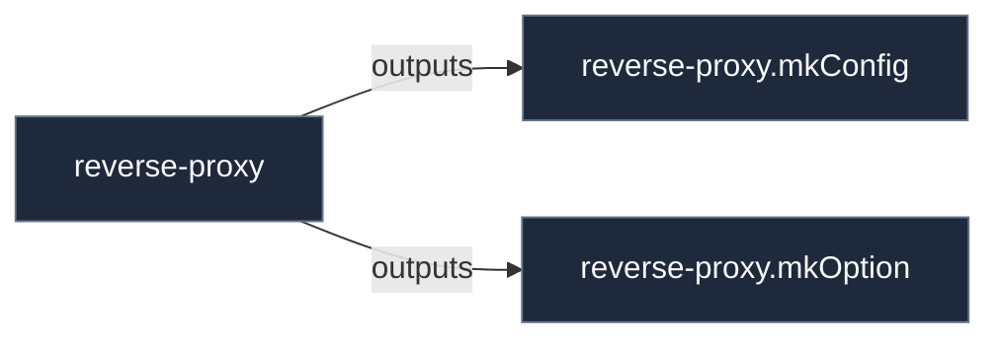

# Library: `reverse-proxy`

Library helpers and constructors for the 'reverse-proxy' contract.

[← Back to Library Documentation](README.md) | [← Back to Main README](../../README.md)

- **Library**: `flake.lib.reverse-proxy`
- **Definition File**: [`modules/contracts/reverse-proxy.nix`](../../modules/contracts/reverse-proxy.nix)

<details>
<summary>Architecture Diagram (click to expand)</summary>



</details>

## Usage

This library namespace can be consumed both internally within repository modules and externally by downstream flakes.

### Internal Usage

```nix
{ self, lib, pkgs, ... }: {
  example = self.lib.reverse-proxy.mkConfig;
}
```

### External Usage

```nix
{
  inputs.nixconf.url = "github:LW-54/nixconf";

  outputs = { self, nixconf, ... }: {
    example = nixconf.lib.reverse-proxy.mkConfig;
  };
}
```

## Exported Symbols

<a id="mkConfig"></a>
### `mkConfig`

Auto-derived configuration binding helper for the 'reverse-proxy' contract.

#### Inputs

- `cfg`: Configuration binding parameter for the 'reverse-proxy' contract.
- `config`: Configuration binding parameter for the 'reverse-proxy' contract.

#### Type

```
reverse-proxy.mkConfig :: AttrSet -> AttrSet
```

#### Examples

```nix
reverse-proxy.mkConfig { inherit config cfg; }
```

<a id="mkOption"></a>
### `mkOption`

Auto-derived option constructor for the 'reverse-proxy' contract.

#### Inputs

- `address`: Submodule option parameter for the 'reverse-proxy' contract.
- `basicAuth`: Submodule option parameter for the 'reverse-proxy' contract.
- `port`: Submodule option parameter for the 'reverse-proxy' contract.
- `subdomain`: Submodule option parameter for the 'reverse-proxy' contract.

#### Type

```
reverse-proxy.mkOption :: AttrSet -> AttrSet
```

#### Examples

```nix
reverse-proxy.mkOption { ... }
```

<a id="types"></a>
### `types`

Custom option types declared under this library namespace:

- `fqdn`: Fully qualified domain name
- `host`: submodule
