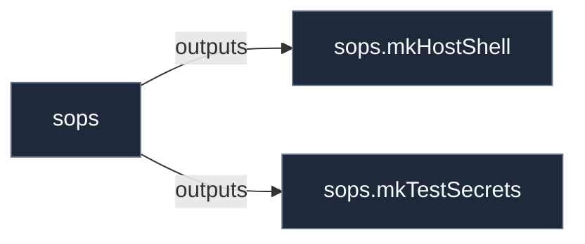

# Library: `sops`

Declarative encrypted secrets provisioning using SOPS and age keys.

[← Back to Library Documentation](README.md) | [← Back to Main README](../../README.md)

- **Library**: `flake.lib.sops`
- **Definition File**: [`modules/implementations/sops.nix`](../../modules/implementations/sops.nix)

<details>
<summary>Architecture Diagram (click to expand)</summary>



</details>

## Usage

This library namespace can be consumed both internally within repository modules and externally by downstream flakes.

### Internal Usage

```nix
{ self, lib, pkgs, ... }: {
  example = self.lib.sops.mkHostShell;
}
```

### External Usage

```nix
{
  inputs.nixconf.url = "github:LW-54/nixconf";

  outputs = { self, nixconf, ... }: {
    example = nixconf.lib.sops.mkHostShell;
  };
}
```

## Exported Symbols

<a id="mkHostShell"></a>
### `mkHostShell`

Constructs a developer shell configured to decrypt host SOPS secrets with the host's age key.

#### Inputs

- `pkgs`: Nixpkgs package set.
- `keyFile`: Path to the age private key file on the host (default: `/persist/sops-nix/key.txt`).

#### Type

```
mkHostShell :: { pkgs, keyFile ? Path } -> Derivation
```

#### Examples

```nix
self.lib.sops.mkHostShell { inherit pkgs; }
```

<a id="mkTestSecrets"></a>
### `mkTestSecrets`

Builds a deterministic test age key plus SOPS-encrypted files holding test stand-in values, used in test mode.

#### Inputs

- `pkgs`: Nixpkgs package set.
- `secrets`: Attribute set of `{ key, format, value }` keyed by secret name.

#### Type

```
mkTestSecrets :: { pkgs, secrets } -> Derivation
```

#### Examples

```nix
self.lib.sops.mkTestSecrets {
  inherit pkgs;
  secrets.api-token = { key = "token"; format = "yaml"; value = "dummy"; };
}
```
