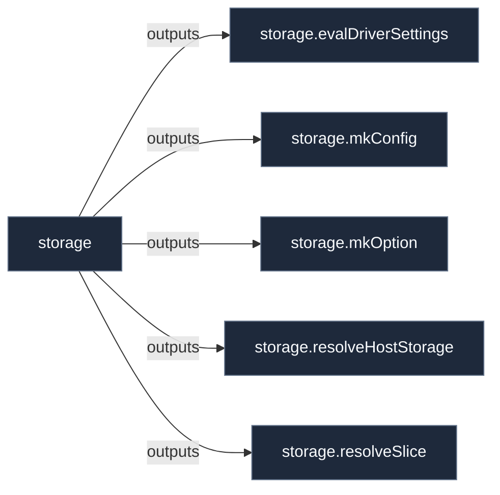

# Library: `storage`

Library helpers and constructors for the 'storage' contract.

[← Back to Library Documentation](README.md) | [← Back to Main README](../../README.md)

- **Library**: `flake.lib.storage`
- **Definition File**: [`modules/contracts/storage/default.nix`](../../modules/contracts/storage/default.nix)

<details>
<summary>Architecture Diagram (click to expand)</summary>



</details>

## Usage

This library namespace can be consumed both internally within repository modules and externally by downstream flakes.

### Internal Usage

```nix
{ self, lib, pkgs, ... }: {
  example = self.lib.storage.evalDriverSettings;
}
```

### External Usage

```nix
{
  inputs.nixconf.url = "github:LW-54/nixconf";

  outputs = { self, nixconf, ... }: {
    example = nixconf.lib.storage.evalDriverSettings;
  };
}
```

## Exported Symbols

<a id="evalDriverSettings"></a>
### `evalDriverSettings`

Evaluates a storage provider instance's `settings` attribute set against its driver's `settingsModule`, returning typed settings and defaults.

#### Inputs

- `driver`: Driver definition attribute set from `storage.drivers`.
- `providerName`: Provider instance name used for error attribution.
- `providerCfg`: Provider instance configuration from `storage.providers`.

#### Type

```
evalDriverSettings :: { driver :: Driver, providerName :: String, providerCfg :: Provider } -> AttrSet
```

#### Examples

```nix
self.lib.storage.evalDriverSettings {
  driver = config.storage.drivers.hetzner-box;
  providerName = "hbox";
  providerCfg = config.storage.providers.hbox;
}
```

<a id="mkConfig"></a>
### `mkConfig`

Auto-derived configuration binding helper for the 'storage' contract.

#### Inputs

- `cfg`: Configuration binding parameter for the 'storage' contract.
- `config`: Configuration binding parameter for the 'storage' contract.
- `name`: Configuration binding parameter for the 'storage' contract.

#### Type

```
storage.mkConfig :: AttrSet -> AttrSet
```

#### Examples

```nix
storage.mkConfig { inherit config cfg; }
```

<a id="mkOption"></a>
### `mkOption`

Auto-derived option constructor for the 'storage' contract.

#### Inputs

- `automount`: Submodule option parameter for the 'storage' contract.
- `enable`: Submodule option parameter for the 'storage' contract.
- `gid`: Submodule option parameter for the 'storage' contract.
- `mountPoint`: Submodule option parameter for the 'storage' contract.
- `protocol`: Submodule option parameter for the 'storage' contract.
- `readOnly`: Submodule option parameter for the 'storage' contract.
- `slice`: Submodule option parameter for the 'storage' contract.
- `uid`: Submodule option parameter for the 'storage' contract.
- `umask`: Submodule option parameter for the 'storage' contract.
- `vfsCacheMode`: Submodule option parameter for the 'storage' contract.

#### Type

```
storage.mkOption :: AttrSet -> AttrSet
```

#### Examples

```nix
storage.mkOption { ... }
```

<a id="resolveHostStorage"></a>
### `resolveHostStorage`

Resolves all providers, slices, mounts, deduplicated SOPS secrets, and reconciler payloads for a single host configuration.

#### Inputs

- `storageCfg`: Evaluated `config.storage` attribute set for the target host.
- `hostName`: Name of the NixOS host being evaluated.
- `placeholders`: Optional function `(store -> key -> string)` emitting runtime SOPS placeholders.

#### Type

```
resolveHostStorage :: { storageCfg :: AttrSet, hostName :: String, placeholders? :: (String -> String -> String) } -> AttrSet
```

#### Examples

```nix
self.lib.storage.resolveHostStorage {
  storageCfg = config.storage;
  hostName = "astrolabe";
}
```

<a id="resolveSlice"></a>
### `resolveSlice`

Recursively resolves a logical slice (`direct`, `crypt`, or `union` across `shared` or `per-host` scope) for a given host into SOPS secret requirements, rclone remote definitions, protocol endpoints, and provider reconciliation items.

#### Inputs

- `storageCfg`: Evaluated `config.storage` attribute set.
- `sliceName`: Name of the slice declared in `storage.slices`.
- `hostName`: Host name used when resolving `per-host` slice paths and secret stores.
- `placeholders`: Optional function `(store -> key -> string)` emitting runtime SOPS placeholders (defaults to `<sops:store:key>`).
- `visited`: Internal accumulator of visited slice names used to detect reference cycles.

#### Type

```
resolveSlice :: { storageCfg :: AttrSet, sliceName :: String, hostName :: String, placeholders? :: (String -> String -> String), visited? :: [String] } -> AttrSet
```

#### Examples

```nix
self.lib.storage.resolveSlice {
  storageCfg = config.storage;
  sliceName = "hbox-backup-host";
  hostName = "astrolabe";
}
```

<a id="types"></a>
### `types`

Custom option types declared under this library namespace:

- `driver`: submodule
- `mount`: submodule
- `provider`: submodule
- `slice`: submodule
