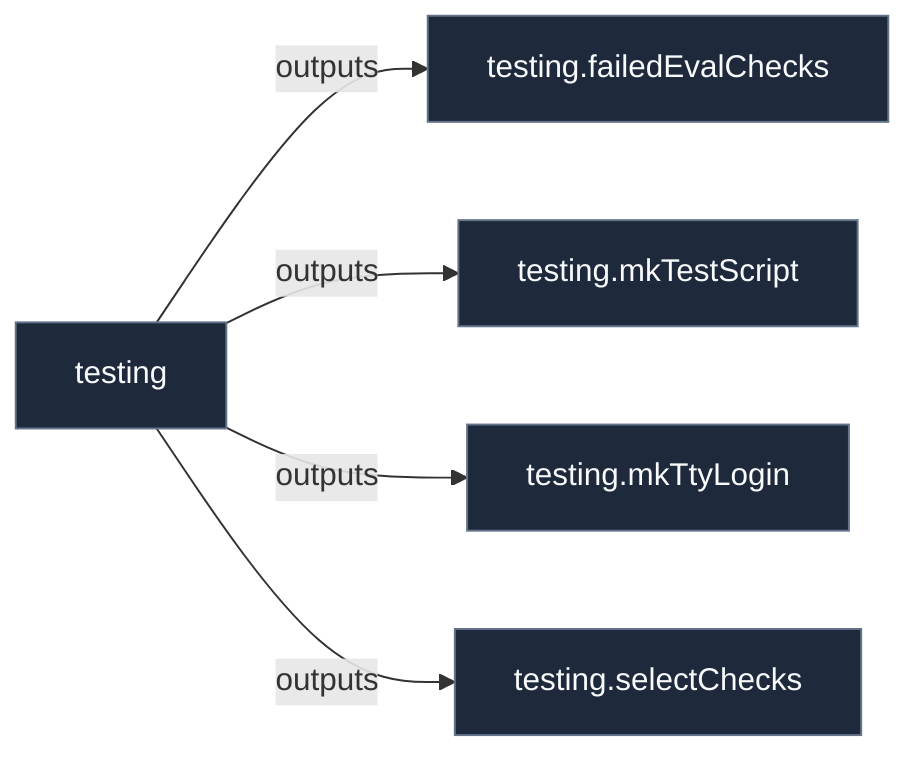

# Library: `testing`

Library helpers and constructors for the 'testing' contract.

[← Back to Library Documentation](README.md) | [← Back to Main README](../../README.md)

- **Library**: `flake.lib.testing`
- **Definition File**: [`modules/contracts/testing.nix`](../../modules/contracts/testing.nix)

<details>
<summary>Architecture Diagram (click to expand)</summary>



</details>

## Usage

This library namespace can be consumed both internally within repository modules and externally by downstream flakes.

### Internal Usage

```nix
{ self, lib, pkgs, ... }: {
  example = self.lib.testing.failedEvalChecks;
}
```

### External Usage

```nix
{
  inputs.nixconf.url = "github:LW-54/nixconf";

  outputs = { self, nixconf, ... }: {
    example = nixconf.lib.testing.failedEvalChecks;
  };
}
```

## Exported Symbols

<a id="failedEvalChecks"></a>
### `failedEvalChecks`

Returns the enabled evaluation checks whose assertion does not hold.

#### Inputs

- `evalChecks`: Attribute set of `testing.evalChecks` entries.

#### Type

```
failedEvalChecks :: AttrSet -> [{ name, message }]
```

#### Examples

```nix
failedEvalChecks config.testing.evalChecks
```

<a id="mkTestScript"></a>
### `mkTestScript`

Renders selected runtime checks into a NixOS test driver script, one subtest per check.

#### Inputs

- `checks`: Attribute set of `testing.checks` entries.
- `tier`: Tier name (`"vm"` or `"install"`).
- `label`: Optional prefix (usually the host name) for subtest titles.

#### Type

```
mkTestScript :: { checks, tier, label ? String } -> String
```

#### Examples

```nix
mkTestScript { checks = config.testing.checks; tier = "install"; label = "x240"; }
```

<a id="mkTtyLogin"></a>
### `mkTtyLogin`

Builds a test driver snippet that logs in on a virtual console with a password and verifies the session.

#### Inputs

- `user`: Account name to log in as.
- `password`: Plain-text password typed at the prompt.
- `tty`: Virtual console number (default: 2, leaving tty1 to greeters).

#### Type

```
mkTtyLogin :: { user, password, tty ? Int } -> String
```

#### Examples

```nix
mkTtyLogin { user = "alice"; password = config.testing.credentials.password; }
```

<a id="selectChecks"></a>
### `selectChecks`

Selects the enabled runtime checks for a tier, sorted by priority and name.

#### Inputs

- `checks`: Attribute set of `testing.checks` entries.
- `tier`: Tier name (`"vm"` or `"install"`).

#### Type

```
selectChecks :: { checks, tier } -> [AttrSet]
```

#### Examples

```nix
selectChecks { checks = config.testing.checks; tier = "vm"; }
```
