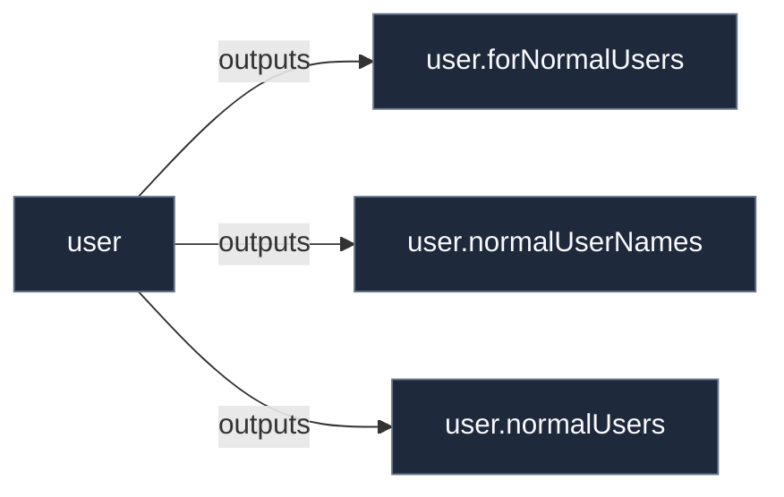

# Library: `user`

Normal user account helper functions and querying utilities.

[← Back to Library Documentation](README.md) | [← Back to Main README](../../README.md)

- **Library**: `flake.lib.user`
- **Definition File**: [`modules/features/user.nix`](../../modules/features/user.nix)

<details>
<summary>Architecture Diagram (click to expand)</summary>



</details>

## Usage

This library namespace can be consumed both internally within repository modules and externally by downstream flakes.

### Internal Usage

```nix
{ self, lib, pkgs, ... }: {
  example = self.lib.user.forNormalUsers;
}
```

### External Usage

```nix
{
  inputs.nixconf.url = "github:LW-54/nixconf";

  outputs = { self, nixconf, ... }: {
    example = nixconf.lib.user.forNormalUsers;
  };
}
```

## Exported Symbols

<a id="forNormalUsers"></a>
### `forNormalUsers`

Maps an attribute set generation function across all normal users.

#### Inputs

- `config`: Evaluated NixOS system configuration.
- `f`: Function `(userName -> userAttrs -> AttrSet)`.

#### Type

```
forNormalUsers :: Config -> (String -> AttrSet -> AttrSet) -> AttrSet
```

#### Examples

```nix
forNormalUsers config (userName: user: {
  data.directories = [".config/example"];
})
```

<a id="normalUserNames"></a>
### `normalUserNames`

Returns list of usernames for all normal users on the system.

#### Inputs

- `config`: Evaluated NixOS system configuration.

#### Type

```
normalUserNames :: Config -> [String]
```

#### Examples

```nix
normalUserNames config
```

<a id="normalUsers"></a>
### `normalUsers`

Filters `config.users.users` down to normal human user accounts (`isNormalUser = true`).

#### Inputs

- `config`: Evaluated NixOS system configuration.

#### Type

```
normalUsers :: Config -> AttrSet
```

#### Examples

```nix
normalUsers config
```
