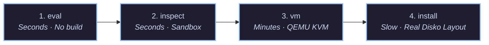

# Testing Architecture & Verification Tiers

Multi-tier automated test harness verifying NixOS host configurations from pure evaluation to full VM booting and installation.

[← Back to Main README](../README.md)

## Overview

`nixconf` employs a 6-tier progressive testing architecture. Tests are ordered cheapest-first so that issues can be detected in seconds during development before invoking virtualisation or disk partitioning:



All tests operate with **stand-in credentials and dummy keys** provisioned by `modules/implementations/sops.nix` in test mode (`config.testing.enable`). Real private keys are never required or decrypted during testing.

## Test Tiers

| Tier | Cost & Runtime | Environment | Scope & Validations |
| :--- | :--- | :--- | :--- |
| **`eval`** | ~0.5s | Pure evaluation | Evaluates the full NixOS system configuration and runs assertion predicates declared in `testing.evalChecks`. Fails fast on misconfigurations without building derivations. |
| **`inspect`** | ~2–5s | Nix build sandbox (no KVM) | Builds system `/etc` artifacts and statically verifies users, PAM modules (`login`, `sshd`), `sudoers`, `fstab`, and systemd unit configurations. |
| **`vm`** | ~1–3 min | QEMU / KVM | Boots the host's actual closure in a virtual machine with virtualised storage and executes runtime tests defined in `testing.checks`. |
| **`install`** | ~5–10 min | QEMU / KVM | Formats a blank virtual disk with the host's real Disko partition layout, installs NixOS via `nixos-install`, reboots from the virtual disk, and verifies persistence across reboots. |
| **`interactive`**| Interactive | Python REPL | Launches the NixOS test driver Python REPL (`start_all()`, `machine.shell_interact()`) for live interactive debugging. |
| **`run`** | Interactive | QEMU VM | Boots a live interactive VM with forwarded SSH port (`localhost:2222`), allowing manual login and exploratory testing. |

## Running Tests via CLI (`test`)

The repository exports a unified `test` runner CLI (packages.md#test) and Justfile shortcuts:

```bash
# Run fast evaluation checks across all hosts (or specify host: just test-eval x240)
nix run .#test -- eval [host]
just test-eval [host]

# Inspect generated /etc and security artifacts without KVM
nix run .#test -- inspect [host]
just test-inspect [host]

# Boot host in QEMU and execute automated checks
nix run .#test -- vm [host]
just test-vm [host]

# Partition real Disko layout, install, and test persistence
nix run .#test -- install [host]
just test-install [host]

# Boot an interactive VM with SSH port-forwarding (localhost:2222)
nix run .#test -- run <host>
just test-run <host>

# Open the test driver Python REPL
nix run .#test -- interactive <host>
just test-interactive <host>

# List available hosts, tiers, and configured test checks
nix run .#test -- list [host]
just test-list
```

## System Architecture

The testing architecture is organized under `meta/tests`:
- NixOS Testing Module: `flake.nixosModules.testing` ([`meta/tests/options.nix`](../meta/tests/options.nix), [`meta/tests/core.nix`](../meta/tests/core.nix))
- Library Helpers: `self.lib.testing` ([`meta/tests/lib.nix`](../meta/tests/lib.nix))
- Test Engine & CLI: [`meta/tests/default.nix`](../meta/tests/default.nix)
